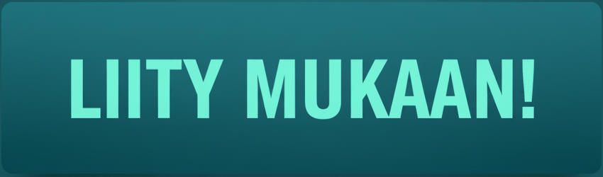
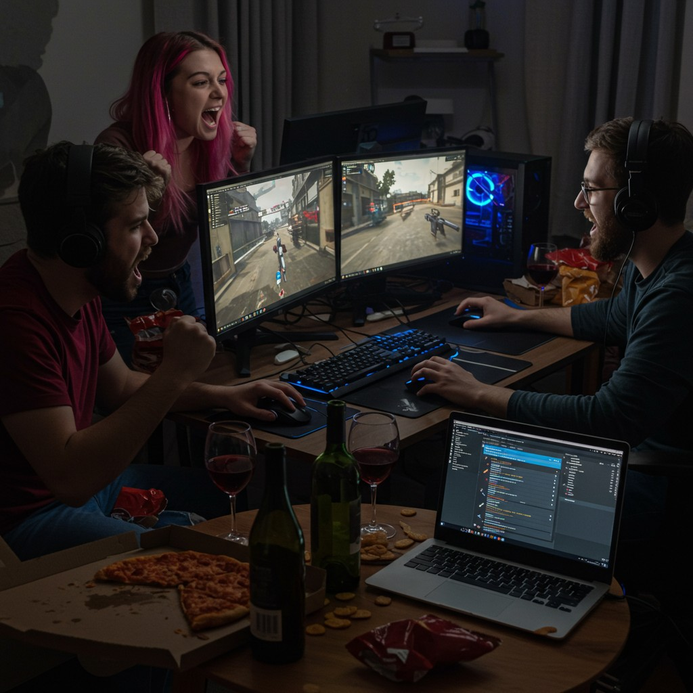

# mimari-fi.github.io
<!DOCTYPE html>
<html lang="fi">
<head>
    <meta charset="UTF-8">
    <meta name="viewport" content="width=device-width, initial-scale=1.0">
    <title>Pelikaista.fi - Tie parempaan pelaamiseen</title>
    <link rel="stylesheet" href="style.css">

</head>

<body>

    <header>
        

        <nav>
            <ul>
                <li><a href="tietoa-meista.html">Tietoa meistä</a></li>
                <li><a href="liity.html">Liity mukaan</a></li>
            </ul>
        </nav>
    </header>

    <section class="hero">
        

           <h2>Pelikaista.fi - Tie parempaan pelaamiseen</h2>
           
Pelikaista.fi on suomalainen verkkosivusto, joka tarjoaa pelaajille vinkkejä, uutisia ja yhteisön tukea parempaan pelaamiseen. Olitpa sitten aloittelija tai kokenut pelaaja, löydät täältä hyödyllistä tietoa ja resursseja.

            
        

       
        

            
            
AI-Generated Image

        

    </section>
   
    <main>
        <h2>Ajankohtaista Kaistalla</h2>
            

                

                    <h3>Uutiset</h3>
                    <article class="item">
                        
                        <h4>Battlefield 6 tulossa pian</h4>
                    </article>
                    <article class="item">
                        
                        <h4>Uusi Call of Duty julkaistu</h4>
                    </article>
                    <article class="item">
                        
                        <h4>Odotettu Arc Raiders julkaistaan</h4>
                    </article>
                

                

                    <h3>Uusimmat artikkelit</h3>
                    <article class="item">
                        
                        <h4>Top 10 vinkkiä parempaan pelaamiseen</h4>
                    </article>
                    <article class="item">
                        
                        <h4>Loppuvuoden 2025 odotetuimmat pelit</h4>
                    </article>
                    <article class="item">
                        
                        <h4>Parhaat pelit ystävien kanssa pelattavaksi</h4>
                    </article>
                

                

                    <h3>Tapahtumat</h3>
                    <article class="item">
                        
                        <h4>Pelikaista.fi -turnaus 2025</h4>
                    </article>
                    <article class="item">
                        
                        <h4>Live stream -tapahtuma</h4>
                    </article>
                    <article class="item">
                        
                        <h4>Yhteisön peli-ilta</h4>
                    </article>
                

            

    </main>

    <footer>
    

        

            <h3>Statsit</h3>
            <ul>
                <li>Jäseniä: 1234</li>
                <li>Pelaajia paikalla: 567</li>
                <li>Edellisen kilpailun voittaja: Mimari</li>
            </ul>
        

        

            <h3>Linkit</h3>
            <ul>
                <li><a href="liity.html">Liity mukaan</a></li>
                <li><a href="tietoa-meista.html">Tietoa meistä</a></li>
            </ul>
        

    

    

        

            <h3>Yhteistyössä</h3>
            <ul>
                <li><a href="#">Yritys A</a></li>
                <li><a href="#">Yritys B</a></li>
                <li><a href="#">Yritys C</a></li>
            </ul>
        

        

            <h3>Pelikaistan some</h3>
            <ul>
                <li><a href="https://facebook.com" target="_blank" rel="noopener noreferrer">Facebook</a></li>
                <li><a href="https://twitter.com" target="_blank" rel="noopener noreferrer">Twitter</a></li>
                <li><a href="https://instagram.com" target="_blank" rel="noopener noreferrer">Instagram</a></li>
            </ul>
        

    

    

        
&copy; 2025 Kaikki oikeudet pidätetään.

    

</footer>
   
</body>

</html>
